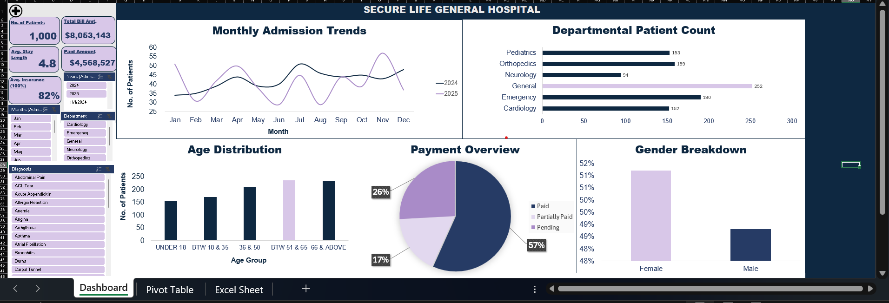

# Hospital Patient and Billing Analytics Dashboard
## Introduction
This project focuses on analyzing hospital patient and billing data using Microsoft Excel. The dashboard provides insights into patient admissions, hospital departments, billing, insurance coverage and payment status.
The aim is to help hospital management understand important patterns in the data and make informed decisions.

## About the Dataset
The dataset contains 1,000 hospital patient records and includes information such as patient demographics, admission, and discharge dates, hospital departments, diagnoses, billing amounts, insurance coverage and payment status.
The dataset was provided for learning and analysis purposes.

## Dashboard Preview

## Project Cover

## Problem Statement
Hospital management needs a clear understanding of patient admissions, departmental activities, billing, insurance coverage and payment status. This project uses data analysis and visualization to present these details in an easy to understand dashboard.
## Key Insights
The analysis revealed the following:
- **Total Patients**: 1,000 patient records.
- **Total Bills**: $8,053,143.
- **Paid Amount**: $4,468,527.
- **Average Insurance Coverage**: 82%
- **Outstanding Payment**: Pending payments amounted to $2,082,786, while partially paid bills amounted to $1,401,830.

  ## Dashboard Chart Analysis
  1. **Payment Status**: Shows the distribution of paid, partially paid, and pending bills.
  2. **Department Analysis**: Compares the number of patients across hospital departments.
  3. **Age Category**: Shows how patients are distributed across different age groups.
  4. **Gender Distribution**: Presents the proportion of male and female patients.
  5. **Admission Trend**: Shows changes in patient admissions over time.
  6. ## Conclusion
  7. This project demonstrates how Microsoft Excel can be used to organize, analyze and visualize hospital data. The dashboard provides useful information about patient demographics, admissions, departmental activities and financial performance. These insights can support better monitoring, planning and decision making in healthcare management.
 **Tools Used**: Microsoft Excel(data analysis, PivotTables, charts, dashboard design and slicers).
